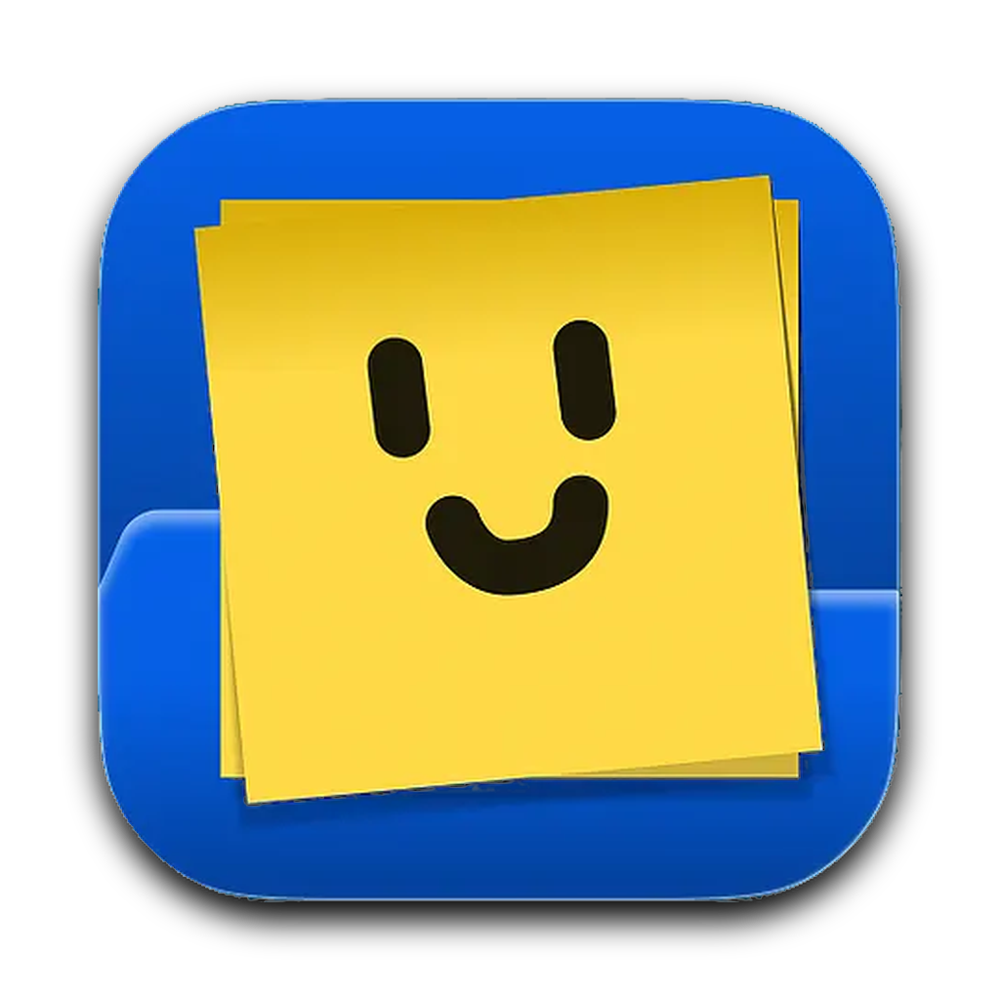
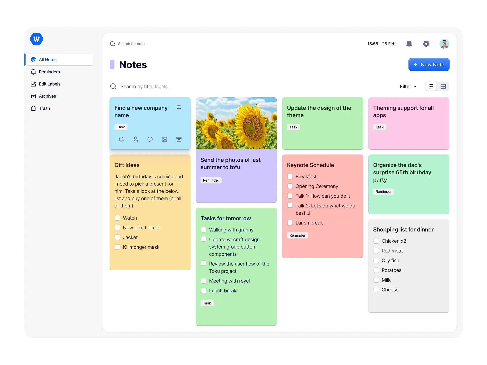
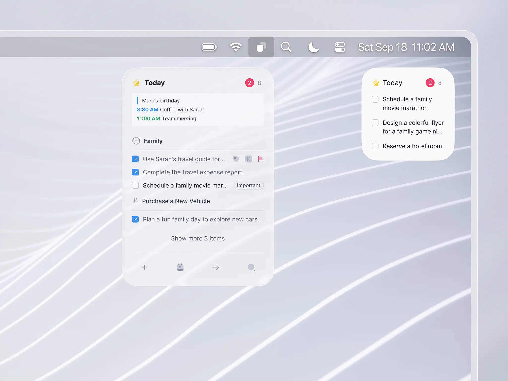

<div align="center">
  
  <h1>Petal 🌸</h1>
  <p><strong>A soft pastel macOS sticky note desk companion designed for focus, delightful organization, and zero clutter.</strong></p>

  <p>
    <a href="https://swift.org"></a>
    
    
    
    
  </p>
</div>

---

## ✨ Features at a Glance

### 1. 🗂 Floating Sticky Notes on Your Desk
- **Pastel Palette**: Butter, Blush, Mint, Sky, Lavender, and Peach with WCAG 2.1 AAA high-contrast graphite ink (`#1C1D21`).
- **Tactile Checklists**: Soft rounded checkboxes with emerald checkmarks, strikethrough, and hover-only delete buttons.
- **Stationary Drag & 1:1 Smooth Resize**: Drag notes anywhere across multiple displays from the top header bar, and smoothly resize the bottom-right corner with precise cursor tracking.
- **Fixed Frosted Toolbar**: Constant 30pt height ultra-thin material capsule toolbar with Reminder, Alarm, Focus Timer, Voice Note, Checklist, and Palette controls.

### 2. 🏷 Ultra-Compact Icon Chip Collapse (`86 × 26 pt`)
- Shrinks open notes into minimal, adorable desk tokens (`[ ● Focus… ^ ]`).
- **Rich Hover Peek Info**: Hovering over a collapsed chip opens a frosted popover card showing the full title, snippet, checklist progress, and active timer countdown.
- Single-click or double-click to instantly expand.

### 3. 📚 Searchable "All Notes Stack Manager" (`⌘L`)
- **Tackle 20–30 Stacked Notes**: When notes overlap and bury each other, press `⌘L` or click the stack icon (`square.stack.3d.up.fill`) on any note to open the floating Stack Manager.
- **Live Instant Search**: Filter all notes instantly by title, text, task, or folder.
- **Unstack & Cascade**: One-click button (`square.split.diagonal.2x2`) that neatly cascades all open notes across your screen in a stair-step grid so every note header is accessible.
- **Bring to Top**: Click any note in the list to immediately raise it to the front and focus it.

### 4. 📋 Masonry Board View (`⌘B`)
- **Full macOS Canvas**: Inspired by modern macOS design principles with a custom sidebar, search bar, and filter tabs (`All Notes`, `Reminders`, `Labels`, `Archives`, `Trash`).
- **Dynamic Multi-Column Masonry**: Cards naturally expand vertically to fit their checklists and text without awkward clipping.
- **Desktop Pop-out**: Click "Pop out" on any card to immediately spawn it as a live floating sticky note on your desktop.

### 5. ⏳ Focus Timer & Mascot Companion
- 25-minute Pomodoro or custom focus durations with a playful smiling mascot companion that changes mood (`awake`, `sleeping`, `celebrating`).
- Sounds and notifications on session completion.

### 6. 🎙 Voice Notes & On-Device Speech Recognition
- Record voice memos attached to any note with live waveform animation.
- Instant on-device transcription directly into your note text using Apple Speech Framework.

---

## 🎨 Visual Designs & Architecture

<div align="center">
  
  <p><em>Petal Board View: Multi-column masonry layout with sidebar categories and pastel note cards.</em></p>
</div>

<div align="center">
  
  <p><em>Petal Menu Bar Companion: Quick capture and desktop sticky widgets.</em></p>
</div>

---

## ⌨️ Keyboard Shortcuts

| Shortcut | Action | Scope |
| :--- | :--- | :--- |
| `⌘N` / `⌃⌥N` | Create a new sticky note | In-app / Global |
| `⌘L` / `⌃⌥L` | Open All Notes Stack Manager & Search | In-app / Global |
| `⌘B` | Open Petal Board Window | In-app |
| `⌘K` / `⌃⌥Space` | Quick Open Spotlight Search | In-app / Global |
| `⌃⌥H` | Hide / Show all notes on desktop | Global |
| `Escape` | Collapse note to pill / Close HUD panel | In-note |

---

## 🏗 Architecture & Codebase

Petal is structured into a clean modular architecture:

```
petal/
├── PetalKit/                       # Pure Swift domain package (Zero UI/AppKit dependencies)
│   ├── Sources/PetalKit/
│   │   ├── Domain/                 # Note, NoteColor, TimerSession, Reminder, Alarm, VoiceClip
│   │   ├── Services/               # Repository, AudioRecorder, Transcriber, Scheduler
│   │   ├── Storage/                # FileNoteRepository (JSON on disk)
│   │   └── Sync/                   # DriveSyncManager (automatic snapshot backup)
│   └── Tests/PetalKitTests/        # Complete XCTest suite
│
├── Petal/                          # Native macOS Application
│   ├── App/                        # AppState (@Observable), PetalApp (@main), AppDelegate
│   ├── DesignSystem/               # Theme, MascotView, SparkleView, PaperCurlShape
│   ├── Features/
│   │   ├── Note/                   # NoteCardView, NoteViewModel, ColorPickerPopover
│   │   ├── StackList/              # NotesStackListView, NotesStackListController
│   │   ├── Board/                  # BoardView (Masonry), BoardWindowController
│   │   ├── MenuBar/                # MenuBarController, MenuBarPopoverView
│   │   ├── QuickOpen/              # QuickOpenView, QuickOpenPanelController
│   │   ├── Timer/ & Voice/         # TimerPopoverView, VoiceRecorderBar, VoicePlaybackPill
│   │   └── Settings/               # SettingsView, OnboardingView
│   ├── Platform/                   # NotePanelController, NotificationManager, SoundPlayer
│   └── Assets.xcassets/            # AppIcon (All macOS resolutions)
│
├── project.yml                     # XcodeGen project specification
├── justfile                        # Workflow automation commands
└── Petal-v1.0.0-macOS-Universal.zip # Compiled Release Artifact
```

---

## 🚀 Building & Running

Petal uses [XcodeGen](https://github.com/yonaskolb/XcodeGen) and [just](https://github.com/casey/just).

### Prerequisites
- macOS 14.0 (Sonoma) or macOS 15+ (Sequoia)
- Xcode 16.0+ with Swift 6.2
- XcodeGen (`brew install xcodegen`)
- Just (`brew install just`)

### Daily Commands

```bash
# Generate the Xcode project from project.yml
just gen

# Run unit tests
just test

# Build debug app
just build

# Launch Petal
just run

# Lint & format code
just lint
```

---

## 📦 Release Artifact

The standalone compiled macOS Universal binary is available as:
- [`Petal-v1.0.0-macOS-Universal.zip`](./Petal-v1.0.0-macOS-Universal.zip)

To install:
1. Download and unzip `Petal-v1.0.0-macOS-Universal.zip`.
2. Drag `Petal.app` into your `/Applications` folder.
3. Open `Petal.app` and start creating your desktop companion notes!

---

## 📄 License

Petal is open-source software licensed under the [MIT License](LICENSE).
